

# Tim Lui

**Fullstack Developer & IT Advisor** · MSc Business Informatics · Switzerland

<!-- TODO: replace the LinkedIn placeholder URL (TODO-your-handle) with your real profile URL before pushing -->

## About

I'm a fullstack developer and IT advisor based in Switzerland, currently completing an MSc in Business Informatics. I build web applications with **TypeScript** and **Next.js**, write portable command-line tools in **Rust**, and use **Python** for data analysis and audit automation.

- **Focus:** scalable web applications, developer tooling and data-driven IT advisory work
- **Exploring:** advanced Rust patterns and cloud-native infrastructure with Docker and Kubernetes
- **Open to:** collaboration on web, tooling and data projects. Reach out via LinkedIn.

## Selected Work

| Project | Description | Built with |
| :-- | :-- | :-- |
| **[Portfolio](https://github.com/tlex-web/portfolio-app)** [Live site ↗](https://tlui.de) | Landscape photography and project portfolio with a WebGL mountain hero, 3D photo carousel and shader-based image transitions. | Next.js 16, TypeScript, Three.js, Framer Motion |
| **[box](https://github.com/tlex-web/box)** | One portable Rust binary bundling 23 command-line tools for PowerShell 7, with `--json` output for scripting, clipboard piping, shell completions and dry-run-first destructive commands. | Rust, clap |
| **[TermPulse](https://github.com/tlex-web/term-pulse-webpage)** [Live site ↗](https://term-pulse-webpage.vercel.app) | Weekly planner that teaches university students to estimate time accurately by comparing planned against actual task durations. | Next.js, React, Tailwind CSS |

## Tech Stack

<!-- Icons from https://skillicons.dev (MIT), stored in assets/stack/ so they can't break. To change a row, re-download e.g.
     https://skillicons.dev/icons?i=ts,js,rust,py,powershell&theme=dark  ->  assets/stack/languages-dark.svg  (and &theme=light) -->
<table>
  <tr>
    <td><b>Languages</b></td>
    <td>
      <picture>
        <source media="(prefers-color-scheme: dark)" srcset="assets/stack/languages-dark.svg">
        
      </picture>
    </td>
  </tr>
  <tr>
    <td><b>Web</b></td>
    <td>
      <picture>
        <source media="(prefers-color-scheme: dark)" srcset="assets/stack/web-dark.svg">
        
      </picture>
    </td>
  </tr>
  <tr>
    <td><b>Databases</b></td>
    <td>
      <picture>
        <source media="(prefers-color-scheme: dark)" srcset="assets/stack/data-dark.svg">
        
      </picture>
    </td>
  </tr>
  <tr>
    <td><b>DevOps & Tools</b></td>
    <td>
      <picture>
        <source media="(prefers-color-scheme: dark)" srcset="assets/stack/tools-dark.svg">
        
      </picture>
    </td>
  </tr>
</table>

## GitHub Activity

<!-- Stats and language cards are regenerated daily by .github/workflows/profile-cards.yml -->

  <picture>
    <source media="(prefers-color-scheme: dark)" srcset="profile/stats-dark.svg">
    
  </picture>
  <picture>
    <source media="(prefers-color-scheme: dark)" srcset="profile/top-langs-dark.svg">
    
  </picture>
   
  <picture>
    <source media="(prefers-color-scheme: dark)" srcset="https://streak-stats.demolab.com/?user=tlex-web&card_width=608&card_height=170&border_radius=6&background=0d1117&border=30363d&stroke=30363d&ring=58a6ff&fire=58a6ff&currStreakNum=e6edf3&sideNums=e6edf3&currStreakLabel=58a6ff&sideLabels=c9d1d9&dates=8b949e">
    
  </picture>

